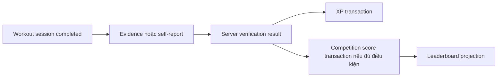

# Kiến trúc đề xuất và quyền sở hữu dữ liệu

**Chưa duyệt.** Bản demo hackathon 08/11/2026 chỉ cần app local; mô hình backend bên dưới là hướng mở rộng GĐ2–5, không phải yêu cầu cài hết ngay. Các bất biến ownership và trust vẫn áp dụng cho demo.

## Cấu trúc vừa đủ

Expo app ở root, `app/` là routes mỏng; `src/modules/<domain>/` có `index.ts`, `domain/`, `data/`, `ui/` khi thực sự cần. `src/ui/` chứa tokens và primitive; `src/app/` ghép các public API thành use case. Chưa cần monorepo package manager, microservice hay DI framework.

Khi backend được duyệt: Supabase Postgres + Auth + Storage, một codebase backend modular monolith. `supabase/migrations/` là nguồn schema/RLS/functions; `supabase/functions/api/` là entry point với các module theo ownership, không tách endpoint thành service độc lập. SQL command là ranh giới transaction cho XP và đăng ký event; Edge Functions xử lý HTTP/provider I/O, không giả định nhiều REST call nằm trong cùng transaction.

GĐ1 chỉ tạo catalog, workout-sessions, progress, UI; pose spike tách sau flag và entry build riêng. Demo Expo Go không import tĩnh native pose, vì flag false không ngăn bundler resolve module. GĐ2 mới thêm profile/plans và backend. Không dựng 12 module rỗng.

## Chủ dữ liệu và hợp đồng

| Domain | Dữ liệu sở hữu | Public API / giới hạn |
|---|---|---|
| identity/profile | Hồ sơ riêng, preferences, consent; credential thuộc Auth | `getProfile`, `updateProfile`, `getCoachConsent`; không xuất auth token hoặc giới hạn sức khỏe vào hồ sơ công khai |
| exercise-catalog | Exercise, revision hướng dẫn, metadata thiết bị/độ khó | `getExercise`, `findExercises`; version đã dùng trong phiên không sửa hồi tố |
| training-plans | Plan, plan items, lịch và revision | `getPlan`, `savePlan`; lưu tham chiếu catalog, không sở hữu session |
| workout-sessions | Session, set/activity records, revision, lifecycle | `start`, `pause`, `resume`, `complete`, `cancel`, `requestCorrection`; snapshot exercise/plan version tại start |
| progress | Read model lịch sử/thống kê | `getHistory`, `getSummary`; tính từ sessions được phép xem, không tạo ledger hoặc sửa session |
| pose-tracking | Runtime frame/keypoint, counter state, calibration config | `start/stop`, stream `PoseObservation`; không quyết định verification/XP; không có raw video table mặc định |
| activity-verification | Evidence bundle, challenge, assessment và revision | `submitEvidence`, `getAssessment`; verifier server tạo `VerificationResult`; client chỉ submit input không tin cậy |
| gamification | XP ledger, score ledger, rules, season, badge/level projection | `applyAssessment`, `reverseAward`, `getStandings`; eligibility theo từng board, không suy từ XP tổng |
| social | Friendship/block, challenge invitations và rules snapshot | `invite/accept/block`, `getChallenge`; không chứa bản sao profile sức khỏe; không tự cộng điểm |
| events | Event/roles, capacity, registration, result revision, dispute | `publish`, `join/withdraw`, `confirm/correctResult`; không được quyền sửa ledger trực tiếp |
| ai-coach | Conversation theo consent, recommendation draft, eval record | `askCoach`, `acceptSuggestion`; chỉ đề xuất, người dùng mới áp dụng plan qua API của plans |
| notifications | Delivery preference/token/outbox delivery status | `enqueue`, `deliver`; không sở hữu sự thật event/session/score |

Backend orchestration gọi public command/query của domain; domain không import coordinator. Flow workout completion → verification → gamification là một chiều. Progress đọc projection/query công khai từ session; không tạo vòng session↔progress. AI đọc snapshot tối thiểu được cấp quyền từ profile/catalog/progress, không đọc tự do toàn bộ DB.

Hợp đồng chung chỉ chứa DTO/schema được version hóa; mỗi module sở hữu contract của mình. `SessionCompleted` gồm eventId, sessionId, userId phía server, revision, sourceType, completedAt, schemaVersion; không chứa XP client yêu cầu. `VerificationResult` gồm assessmentId/revision, sessionId/revision, evidenceDigest, policyVersion, status, trustTier, reasonCodes, assessedAt, issuer. `AwardReceipt` gồm ledger IDs và trạng thái xử lý; UI không diễn giải pending thành đã cấp.

ESLint sau bootstrap cấm deep import qua `modules/<other>/{domain,data,ui}/...` kể cả relative path; cross-domain chỉ vào public `index.ts`/contracts. Không barrel export implementation. Thêm kiểm tra dependency cycle nếu cấu trúc cần; database migration review phải bảo vệ ownership tương tự, vì lint TS không kiểm tra SQL.

## Dữ liệu sơ bộ

UUID cho identity/entity; timestamp server UTC + IANA timezone cho event/lịch. Giá trị ngày địa phương chỉ để hiển thị, không dùng làm đồng hồ tin cậy của client.

| Nhóm bảng khi cần | Trường/invariant chính |
|---|---|
| profiles / consents / public_profiles | user_id; consent purpose/version/revoked_at; chỉ public projection tối thiểu theo opt-in |
| exercises / exercise_versions / plans / plan_items | stable exercise_id + version; plan owner và version |
| sessions / session_items / session_revisions | owner_id, client_session_id unique theo owner, lifecycle, sync_version, occurred_at tự khai, received_at server; activity type là discriminated schema theo môn |
| evidence / verification_challenges / assessments | Owner: activity-verification; session_id + revision, evidence schema/model/config version, challenge expiry/consumed_at; assessment append revision |
| xp_ledger / competition_ledger | source, session_id, entitlement_key, rule_version, amount delta, reversal_of, actor/reason, assessment_revision |
| friendships / social_challenges / social_challenge_members | Owner: social; cặp quan hệ unique, block status, immutable rules khi bắt đầu; không có quyền sửa verification_challenges |
| events / event_roles / registrations / result_revisions / disputes | UTC time + timezone, deadline/capacity, unique(event_id,user_id), status/version, organizer, result audit |
| operation_receipts / outbox / consumer_receipts | scope + idempotency_key + request_hash; unique business event; retry/lease/status |

Không tạo bảng cho các phần chưa triển khai. Không lưu event roster kèm email/giới hạn vận động. Migrations có seed mẫu riêng; không đưa seed fake vào dữ liệu thật âm thầm.

## Phiên tập, offline và xung đột

Lifecycle: `active ↔ paused → completed`, và `active|paused → cancelled`; completed/cancelled là terminal. `syncStatus` (local/pending/synced/conflict) và `verificationStatus` là hai trục riêng. Không dùng một enum cho cả ba.

Demo có tối đa một phiên active/paused trên máy. `start` chạy trong serialized command queue: nếu có phiên hiện hành thì trả lại cùng ID; chỉ tạo ID mới sau complete/cancel. Train hiện Resume khi có phiên; Back chỉ rời screen, không ngầm complete/cancel. Kiểm tra double-tap Start, Back→Start và reopen→Start. GĐ2 mở rộng invariant này phía server theo owner bằng khóa/constraint thích hợp; UUID mới không được dùng để né kiểm tra session overlap và quota.

Persistence demo: một snapshot versioned do workout-sessions sở hữu, chứa tập sessions và con trỏ phiên hiện hành; Progress derive history từ snapshot này, không có history store riêng. Start/pause/complete/cancel/reset dùng cùng write queue và một lần thay snapshot. Chỉ publish trạng thái “saved” sau storage write thành công; lỗi giữ bản bền cuối cùng và draft có thể retry, không silently reset khi parse/schema lỗi. Một snapshot giảm lỗi nhiều key, không phải bảo đảm ACID/power-loss của AsyncStorage. Test kill/reopen trước/sau complete, failed write và retry cùng ID; đúng một history entry và không còn active session đã completed.

Phiên local có UUID và command UUID giữ nguyên qua retry, owner scope rõ; GĐ1 không có auth nên chỉ lưu trên máy và có nhãn demo. GĐ2 cache/queue riêng từng tài khoản, logout không gửi queue sang người kế tiếp. Bắt đầu offline vẫn tập được nhưng chỉ tự khai; không cấp trust bằng timestamp của điện thoại. Server dùng received_at, giới hạn thời gian/overlap và policy; board cần online challenge phải bắt đầu online.

Complete là command idempotent, revision precondition. Race complete/cancel chỉ một chuyển trạng thái thành công dưới row lock/version; retry nhận cùng receipt. Edit sau complete là correction có revision và lý do; không mutate bằng chứng đã đánh giá. Xung đột hai máy trả conflict + bản server, không last-write-wins đối với completed session/điểm. Schema local có version; migrate trước đọc, không parse lỗi rồi âm thầm xóa dữ liệu.

## Luồng điểm và tính nhất quán

XP không phải nguồn điểm xếp hạng. Một assessment có thể cho XP cá nhân mà không có competition score. T0 self-report, T1 camera-assisted, T2 policy-eligible, T3 adjudicated chỉ là trust tier; từng board phải có policy/version riêng về tier, môn, thời gian và loại evidence. GĐ3 board chưa có cơ chế verified không được lấy self-report vào rồi gắn nhãn “verified”; demo board chỉ dùng fixture ghi nhãn.

1. `completeSession`: xác thực JWT/owner; validate state/revision/payload/time; trong một DB transaction ghi completed revision + receipt + outbox. Client không gửi amount, userId có thẩm quyền hoặc status verified.
2. Verifier đọc outbox bằng claim/lease; tính assessment ở ngoài transaction nếu cần I/O. Commit assessment + outbox event trong một transaction, kiểm tra session/evidence revision còn hiện hành; consumer xử lý lặp phải trả cùng kết quả hoặc revision có chủ đích.
3. Award command trong transaction: khóa entitlement/session và quota row `(user, rule_period)`; đọc assessment có thẩm quyền, kiểm tra chưa obsolete/revoked; tính XP và điểm board, ghi ledger append-only + outbox. Rule version lưu để audit nhưng **không nằm trong unique key cho phép thưởng lại cùng quyền lợi**.
4. Unique business entitlement, ví dụ `(user_id, session_id, reward_kind)` cho XP gốc; điểm thi đấu `(board_id, user_id, session_id, score_kind)`. Idempotency key khác vẫn không cấp thêm. Upgrade assessment chỉ tạo delta đến entitlement mới hợp lệ, không thưởng lại toàn bộ.
5. Projector xử lý outbox at-least-once với unique `(consumer,event_id)`; ghi receipt và cập nhật projection trong cùng transaction, hoặc rebuild từ ledger. Lag có trạng thái pending; lỗi notification không rollback phiên/điểm. Retry có backoff, hàng lỗi cuối và thao tác replay được audit; không hứa exactly-once delivery.

Idempotency receipt khóa theo actor + operation + key, kèm request_hash; cùng key khác body trả conflict. Bảo vệ business key vẫn tồn tại sau khi receipt được dọn. Không đọc số dư rồi cộng ở client. Cấp điểm, quota và thay đổi eligibility khóa theo thứ tự thống nhất để hạn chế deadlock; deadlock được retry bằng key cũ.

Reversal/adjustment tham chiếu transaction gốc, có actor/reason/request ID; unique adjustment identity chống double reversal. Tổng delta không vượt mức muốn thu hồi. Hủy/xóa/sửa activity hoặc kết quả phải tạo invalidation và bù điểm cùng đường command, không delete ledger. Account deletion phải có policy giữ audit tối thiểu/pseudonym hóa theo thị trường trước production, chưa cam kết retention pháp lý.

Quy tắc đề xuất: trần XP theo ngày và hoạt động, không thưởng vô hạn theo rep/duration; nghỉ không làm mất điểm đã kiếm. Hòa điểm dùng shared rank, display order ổn định bằng ID không biến thành lợi thế thi đấu. Mùa/tuần có UTC cutoff được tính từ timezone cố định của board; không thay timezone điện thoại để reset trần. Con số trần và công thức chưa chốt.

## Phân quyền

- App chỉ có publishable key; secret/service role/AI key ở server. Mọi bảng exposed có RLS và grants tối thiểu. Read view phải tôn trọng quyền người gọi; server credentials bypass RLS thì command vẫn phải kiểm tra actor/role, không coi service role là permission của người dùng.
- Self profile/session/plan chỉ owner đọc/command; catalog published cho audience đã chốt; organizer chỉ event mình có role. Participants không đổi role/capacity/results. Public roster chỉ display name đã đồng ý, không lộ private profile.
- XP/competition ledger/assessments: revoke client INSERT/UPDATE/DELETE; client không được execute internal award/verify RPC. SQL privileged functions có search_path cố định, schema-qualified references và EXECUTE grants rõ; không để helper SECURITY DEFINER mặc định công khai. [RLS](https://supabase.com/docs/guides/database/postgres/row-level-security), [Database functions](https://supabase.com/docs/guides/database/functions)
- Storage private, path owner + object scope, signed URL ngắn hạn khi cần; không lưu raw video mặc định. Evidence payload không chứa token/PII thừa; dữ liệu camera cũng có thể nhạy cảm dù không còn ảnh.
- Tuổi 15–17: demo dùng dữ liệu tổng hợp/adult testers; trước pilot thật phải chốt jurisdiction, consent, visibility, moderation/report/block và quyền dùng AI. Không bật public location, roster, social discovery hay coach cá nhân hóa cho trẻ vị thành niên dựa trên giả định chưa duyệt.

## Event concurrency và kết quả

Event `draft → published → ongoing → completed`; draft/published/ongoing có thể cancelled theo policy. Role, trạng thái và server clock quyết định được join/withdraw/publish/confirm, không dựa client button.

Join lock event capacity row trong transaction, kiểm tra status/deadline/eligibility, unique registration và reserved count; withdraw cũng dùng cùng lock. Retry không giữ hai chỗ. Đổi capacity không nhỏ hơn số đăng ký còn hiệu lực. Lịch đã công bố đổi phải có version + notification outbox.

Kết quả là revision, có submitted/confirmed/disputed/corrected, người xác nhận và lý do. Người dự thi không tự confirm. Người tổ chức đồng thời thi phải có reviewer độc lập cho kết quả của mình; demo chưa có quy trình này thì không chạy giải thật. Correction tạo event invalidation cho gamification; award của revision cũ đến trễ phải bị từ chối. Giải thưởng mô tả/xác nhận bởi organizer, không có thu phí/auto-payout.

## AI/provider và kiểm chứng

Chỉ thêm `CoachProvider.generate(context, signal)` khi triển khai GĐ4; timeout/cancel, schema validation, catalog IDs và policy là trách nhiệm server. Không tạo generic provider framework. Pose engine có adapter ở spike vì thay engine là rủi ro thật; notifications có adapter khi push thực sự được thêm. Feature flag experimental được server enforce cho phần đặc quyền.

Test quan trọng: state machine transitions; owner A/B/anon/direct RPC/RLS; complete 20 lần với key giống/khác; crash sau mỗi commit rồi retry; concurrent quota; event còn 1 chỗ với 20 join; correction chạy đồng thời award; duplicate/reordered outbox; revoked consent/AI timeout/invalid output; offline queue đổi user/schema cũ. Kết quả kỳ vọng: một session/một entitlement, không oversell, không điểm cũ sống lại, không leak dữ liệu.
